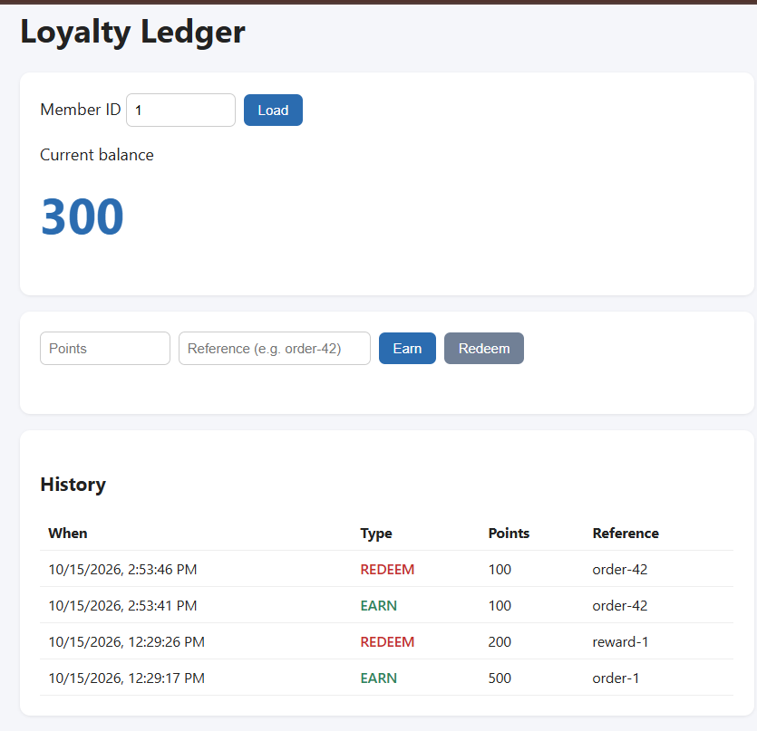

# Loyalty Points Ledger

A Spring Boot REST API for tracking loyalty points. Every earn and redeem is stored as a transaction, and the balance is calculated from those transactions. Retried requests are safe, and redemptions can't overdraw a balance.



## Tech stack
Java 21, Spring Boot 4, Spring Data JPA, PostgreSQL 16, Docker, JUnit 5, Mockito

## Run locally
Start PostgreSQL:
```bash
docker run --name ledger-db -e POSTGRES_DB=ledger -e POSTGRES_USER=ledger -e POSTGRES_PASSWORD=ledger -p 5433:5432 -d postgres:16
```

Start the app:
```bash
./mvnw spring-boot:run
```

Open http://localhost:8080 for the dashboard.

## API

| Method | Path | Description |
|---|---|---|
| POST | `/members` | Create a member |
| POST | `/members/{id}/earn` | Add points (idempotent) |
| POST | `/members/{id}/redeem` | Spend points; returns 409 if the balance is too low |
| GET | `/members/{id}/balance` | Current balance |
| GET | `/members/{id}/transactions` | Paginated history |

Example:
```bash
curl -X POST http://localhost:8080/members/1/earn \
  -H "Content-Type: application/json" \
  -d '{"points":500,"reference":"order-1","idempotencyKey":"earn-1"}'
```

Sending the same `idempotencyKey` again returns the original transaction and does not add points twice.

## Design decisions
- **Balance from transactions:** no stored balance field, so it can't drift from the history.
- **Idempotency keys:** a unique key on each transaction prevents duplicate earns from network retries.
- **Pessimistic lock on redeem:** the member row is locked during redemption, so concurrent requests can't overdraw.

## Tests
```bash
./mvnw test
```